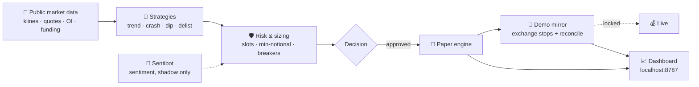

<div align="center">

# ⚡ QuantOS

**A careful, self-supervising crypto futures trading system that proves itself on paper before it touches money.**


</div>

---

## ✨ What it does

- 📡 **Watches Binance USD-M (USDC) futures** from public data, scanning every 30 s for a small library of pre-registered strategies.
- 🛡️ **Puts every idea through hard risk rules**: exchange minimums, reserved slots, leverage ≤ 3×, daily-loss stop and drawdown pause. A rejected trade is final.
- 🧪 **Trades on paper, then on Binance Demo money** with real exchange stop-losses and reconciliation. Live trading stays locked behind an explicit flag plus a confirm file.

## 📊 Status

| Run | Capital | Rules | Where it trades | State |
|---|---|---|---|---|
| **Paper 2%** | $50 virtual | all active strategies, 2% risk/trade | simulated fills on live prices | 🟢 running |
| **Paper 5%** | $50 virtual | crash & dip rules only, 5% risk/trade | simulated fills on live prices | 🟢 running |
| **Demo 2%** | $50 demo money | same as Paper 2% | real orders on Binance Demo futures | 🟢 running |
| **Live** | – | – | Binance mainnet | 🔒 OFF until a go/no-go review |

## 🧭 How it works



## 🧠 Strategy library

| Strategy | Idea | Status | Held-out evidence |
|---|---|---|---|
| `crash_flush_e2` | Buy majors after a crash with collapsing open interest | ✅ active (2% + 5%) | **+2.9% per crash episode**, CI [+1.2, +4.6], 21 episodes |
| `alt_dip_reversal` | Buy alts whose 24h drop is in the extreme 1% tail | ✅ active (2% + 5%) | **+2.5% per crash episode**, CI [+0.9, +4.2], 21 episodes |
| `delist_short_e17` | Short coins right after a delisting announcement | ✅ active | source-only, unverified |
| `tsmom_4h` | 4-hour time-series momentum | 🟡 paper 2% only | failed held-out (+0.18%/trade, CI includes 0) |
| `turtle_55`, `vol_squeeze_breakout` | Breakout trend rules | 🟡 paper 2% only | untested |
| `ema_atr_ref`, `donchian_atr_ref` | Original reference rules | ⛔ disabled | no edge |

> Both "active" edges are small-sample and use today's surviving coins. Treat them as promising, not proven.

## 🛡️ Risk rules

- **Size from risk:** 2% (or 5%) of current equity is at risk per trade, sized at 90% of that budget so fills stay inside it.
- **Exchange minimums respected:** an order is raised to Binance's minimum only if it then risks ≤ 3% (5% profile: ≤ 5%); otherwise it's skipped, with the reason logged.
- **Reserved slots:** 1 crash, 1 event, 1 trend, so a slow trend trade can't block a crash trade.
- **Breakers:** daily-loss stop at 6% (5% profile: 15%) and drawdown pause at 20% (35%). Leverage ≤ 3×.
- **Restarts never close trades:** a restart pauses the run and restores protected positions. Only an explicit stop, the deadline or the kill switch flattens.

## 🚀 Quick start

```bash
# 1. install (Python 3.11+, no third-party runtime dependencies)
python3 -m venv .venv && .venv/bin/pip install .
.venv/bin/quantos doctor                 # clock + market compatibility check
.venv/bin/quantos strategies list        # the strategy library

# 2. start the supervised runs (paper 2%/5%, demo, Sentibot) as macOS services
.venv/bin/python scripts/deploy_three.py install
.venv/bin/python scripts/deploy_three.py install-dashboard   # → http://localhost:8787

# 3. check on everything in ten lines
.venv/bin/python scripts/health_summary.py
```

| I want to… | Command |
|---|---|
| See everything live | open **http://localhost:8787** |
| Emergency-stop one run | `touch "$HOME/Library/Application Support/QuantOS/<run>/KILL"` |
| Stop all services gracefully | `.venv/bin/python scripts/deploy_three.py uninstall` |
| Deploy new code (keeps positions) | `.venv/bin/python scripts/deploy_three.py restart-quantos` |

## 🗺️ Repo map

```text
QuantOS/
├── src/quantos/
│   ├── paper/      # runtime, strategies, risk, engine, dashboard, health
│   └── live/       # signed Binance client, orders, reconcile, kill switch, demo mirror
├── tests/          # 313 unit tests (no network)
├── scripts/        # deploy_three.py · health_summary.py · testnet_roundtrip.py
├── configs/        # strategy manifests
├── docs/           # current architecture and research protocols
└── legacy/         # everything before V4: specs, research rounds, archived bots
```

## 🔬 Research honesty

We'd rather know the truth than fit a backtest. Every idea is pre-registered, selected on 2020 to mid-2023 data, checked once on held-out 2023–2024 data, and penalized for the number of variants tried.

- **About 4,170 variants** logged in the edge ledger: calm-market grids and mean reversion, trend sweeps, cross-sectional momentum and low-beta, funding signals, new-listing fades, and more.
- **Survivors:** only `crash_flush` and `alt_dip`. Everything else is documented as dead, so it never gets retested by accident.
- The real test is forward: the paper and demo runs, and a Hyperliquid wallet-copy experiment.

📚 Full write-ups live in [`legacy/edge_vault/`](legacy/edge_vault/), and the summary is in [`HUNT_SUMMARY_2026-10-31.md`](legacy/edge_vault/HUNT_SUMMARY_2026-10-31.md).

## 🔐 Safety

- **No keys in the repo, ever.** Keys live in a private file outside it (`chmod 600`), read only via `QUANTOS_KEY_FILE`, and never printed or logged.
- **Mainnet is locked:** it needs an explicit flag **and** a confirm file. The CLI only exposes `paper`, `dry-run` and `testnet`.
- **Withdraw-disabled keys only**, IPv4-forced signed requests, and an alert the moment Binance rejects the key.
- Exchange-native reduce-only stop-loss on every demo/live position, plus a reconcile-and-flatten kill switch.

## 🗄️ Legacy

Everything from before V4 lives in [`legacy/`](legacy/): the V1 spec-first design, the alpha-discovery funnel, the V3 paper engine, archived bots (QuantOS-PM, S199 PaperKit, Claude-QuantOS) and every research round, with an index in [`legacy/README.md`](legacy/README.md).

---

<sub>⚠️ QuantOS is a personal research project. Nothing here is financial advice, and past or paper results don't guarantee future returns. Trading leveraged futures can lose more than you put in.</sub>
